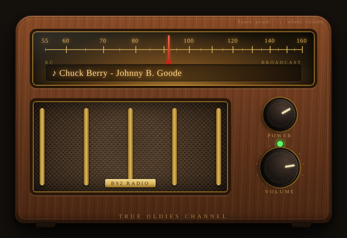

# True Oldies Channel

A tiny Windows desktop app, styled like a vintage tabletop radio, that tunes in to the True Oldies Channel stream and shows the song now playing.



## Download

Grab **[`dist/TrueOldiesChannel.exe`](dist/TrueOldiesChannel.exe)** — a single file, no install. Double-click and it warms up and starts playing.

Windows SmartScreen may warn the first time because the exe isn't code-signed: choose **More info → Run anyway**.

## Controls

| Control | Action |
|---|---|
| **POWER** knob | click, or press `Space` |
| **VOLUME** knob | drag, mouse wheel, or `↑` / `↓` |
| Dial display | song now playing (also shown in the window title) |
| Pilot lamp | amber = tuning in · green = playing · red = connection problem |

The player reconnects automatically if the stream drops.

### Command-line options

```
TrueOldiesChannel.exe -volume 50
TrueOldiesChannel.exe -standby                # start switched off
TrueOldiesChannel.exe -url https://.../stream.mp3
```

## How it works

- Written in Go; cross-compiles to a self-contained Windows exe with `CGO_ENABLED=0`.
- Streams the MP3 over HTTP/1.1 with `Icy-MetaData: 1`, strips the interleaved ICY metadata (that's where the song title comes from), decodes with [go-mp3](https://github.com/hajimehoshi/go-mp3) and plays through WASAPI via [oto](https://github.com/ebitengine/oto).
- The radio face is plain HTML/CSS embedded in the binary and rendered with the Microsoft Edge WebView2 runtime (preinstalled on Windows 10/11) through [go-webview2](https://github.com/jchv/go-webview2).
- A diagnostic log is written to `%LOCALAPPDATA%\TrueOldiesChannel\radio.log`.

## Build from source

Requires Go 1.24+.

```sh
GOOS=windows GOARCH=amd64 CGO_ENABLED=0 go build -ldflags="-s -w -H windowsgui" -o TrueOldiesChannel.exe .
```

Pushes to `main` also build the exe in GitHub Actions (see the **Actions** tab for the artifact).

## Project layout

| File | Purpose |
|---|---|
| `main.go` | window setup, Go ↔ UI bridge |
| `engine.go` | HTTP streaming, MP3 decode, playback, auto-reconnect |
| `stream.go` | ICY metadata stripping, song-title parsing, volume scaling |
| `ui.html` | the radio face |
| `log.go` | diagnostic log |
| `title_windows.go` | native error dialog |
